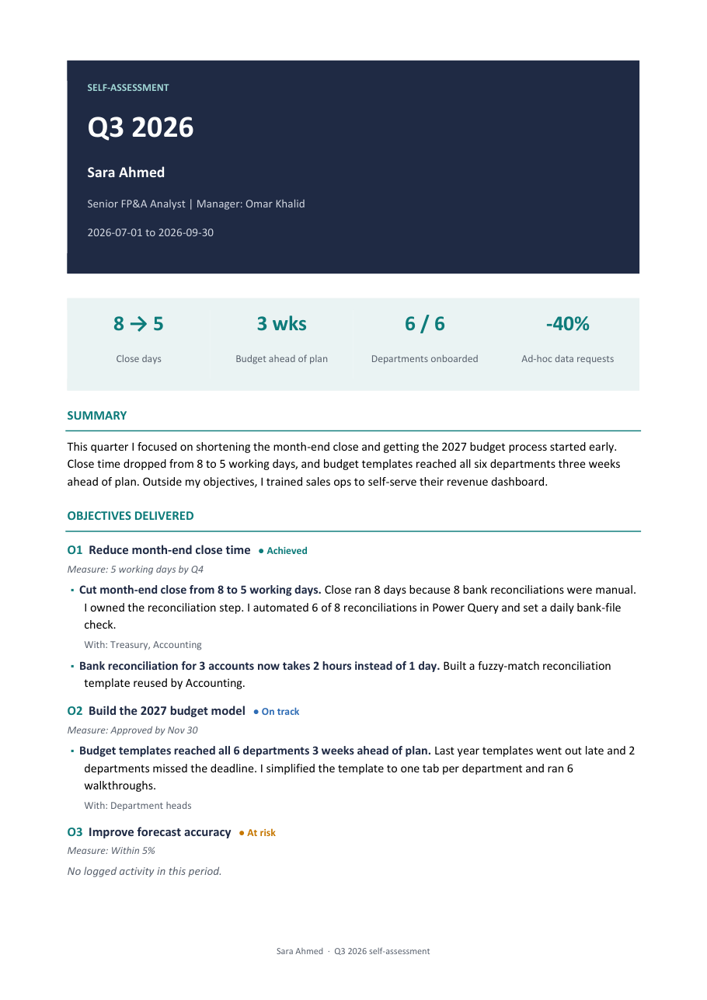

# Brag Doc: your performance review, written every day in 3 minutes

Most of us sit down to write our performance review and can't remember what we did in March.

**Brag Doc** is a free Claude skill that fixes that. Every workday evening it asks you five short questions. You answer by typing or by voice on your phone. At the end of the quarter, half year or year, it turns those answers into a designed self-assessment linked to your objectives, ready for the conversation with your manager.



## What it does

| When | What happens |
|---|---|
| **Every workday, 7pm** | A reminder. You open Claude and say *"log my day"*. Five questions, one at a time: **tasks, impact, stakeholders, blockers, what you learned**, plus an optional highlight. |
| **If you're vague** | Claude follows up. *"Saved time"* becomes *"about how many hours?"* It never invents numbers for you. |
| **No answer?** | Reminders at 8, 9 and 10pm, then it stops. |
| **On leave** | Say *"I'm off this week"* and reminders pause. |
| **Every week** | A 5-line update for your manager, drafted in Gmail for you to review and send. |
| **Quarter / H1 / year-end** | A designed Word review: objectives delivered, impact in numbers, key stakeholders, the extra mile, what you learned, and space for stakeholder feedback. |

It follows common HR guidance for strong self-assessments: the **STAR** structure (Situation, Task, Action, Result), **impact in numbers**, every achievement **linked to an objective**, and an honest development area. It also uses the "brag document" idea from [Julia Evans](https://jvns.ca/blog/brag-documents/).

Your entries are saved as dated Google Docs in a **Brag Doc** folder in your own Google Drive. Nothing is stored anywhere else.

## Before you start

- A **paid Claude plan** (Pro or higher) is needed for skills and for the smart reminders.
- **Check your company's AI and data policy.** You'll be logging work details. If confidential figures or client names aren't allowed in AI tools, keep entries general.

## Setup (about 15 minutes, once)

### 1. Download the skill
Download [`brag-doc.zip`](brag-doc.zip) from this repo. Don't unzip it.

### 2. Upload it to Claude
On **claude.ai** (web or desktop app), open **Settings**, go to the **Skills** section, choose **Upload skill** and select `brag-doc.zip`. Make sure the skill is switched on.

Also turn on **Code execution and file creation** in Settings. The review is built with a small script.

### 3. Connect Google Drive and Gmail
In **Settings → Connectors**, connect **Google Drive** (required) and **Gmail** (optional, for the weekly manager draft).

### 4. Run setup (from your phone or computer)
Open a new chat and say:

> **Set up brag doc**

Claude creates the Brag Doc folder in your Drive and asks for your name, job title, manager, working days and weekly update day.

Then upload your yearly objectives (Word, PDF or Excel) and say:

> **Here are my objectives**

### 5. Turn on reminders
Pick one:

- **Smart reminders (recommended):** create a Claude Code routine using the prompt in [`brag-doc/references/routine-setup.md`](brag-doc/references/routine-setup.md). It only reminds you if you haven't logged that day, and it stays quiet during leave.
- **Simple reminders:** a repeating calendar event at 7pm on workdays with extra notifications at 8, 9 and 10pm. The same file has step-by-step instructions.

That's it. From now on, open the Claude app on your phone at 7pm and say **"log my day"**. Voice input works well here.

## Using it on your phone

Setup (steps 1 to 5) is done once on **claude.ai in a browser**. A phone browser works, but a computer is easier. After that, everything happens in the **Claude mobile app**, which uses the same account, so your skill and connectors are already there.

| When | On your phone |
|---|---|
| 7pm | A **"Brag Doc: 3 minutes for today?"** email arrives in your Gmail |
| Then | Open the **Claude app**, start a new chat, tap the **mic** and say *"log my day"* |
| 3 minutes | Answer the 5 questions by voice or text. Claude saves the entry to your Drive |
| Leave | Say *"I'm on leave from 5 to 12 October"*. No emails until you're back |
| Thursday | Say *"weekly update for my manager"*. The draft appears in your Gmail app to review and send |
| End of quarter | Say *"prepare my Q3 review"*. Claude gives you a Word file you can open, share or save as PDF |

### Setting up the smart reminder (no coding)
1. On a computer, go to **claude.ai/code/routines** and create a new routine.
2. Paste the reminder prompt from [`brag-doc/references/routine-setup.md`](brag-doc/references/routine-setup.md).
3. Schedule: **every workday, hourly from 7pm to 10pm** in your time zone.
4. Attach the **Google Drive** and **Gmail** connectors, then save.
5. Click **Run now** once. After you've logged a day, it should report "entry found, no reminder".

## Things you can say

| Say | What happens |
|---|---|
| `log my day` | The daily check-in |
| `I'm on leave 5 to 12 October` | Pauses reminders |
| `skip today` | Skips one day |
| `here are my objectives` + file | Sets or updates your yearly objectives |
| `weekly update for my manager` | Drafts the weekly email |
| `prepare my Q3 review` | Builds the quarterly review |
| `prepare my H1 self-assessment` / `year-end review` | Half-year or annual review |

## What's inside

```
brag-doc/
├── SKILL.md                         the instructions Claude follows
├── references/
│   ├── daily-questions.md           the 5 questions and follow-ups for vague answers
│   ├── hr-review-criteria.md        how a strong self-assessment is written
│   ├── storage-format.md            how entries are saved in Google Drive
│   └── routine-setup.md             reminder setup
├── assets/
│   └── weekly-update-template.md    the manager email format
└── scripts/
    ├── check_review.py              flags claims with no numbers or no objective link
    └── build_review.py              builds the designed Word review
```

See [`examples/`](examples/) for a sample review built from fictional data.

## Troubleshooting

**"Insufficient scope" or Claude can't find or create files in Drive.** When you connected Google Drive, not all permissions were granted. Go to **Settings → Connectors → Google Drive**, disconnect, connect again, and **tick every permission box** on Google's screen.

**No reminder email.** Check your routine at claude.ai/code/routines and open its last run. "Entry found" means you had already logged that day. Also check your Gmail spam folder the first time.

## Known limits

- **Claude can't message you first.** A skill only runs when you open a chat, so reminders come from a Claude Code routine or your calendar.
- **Entries are separate files.** The Google Drive connector can create Docs but not edit them, so each day is its own Doc and corrections are saved as a new version (`v2`). You can always edit any Doc yourself in Google Docs.
- **Stakeholder reference requests** (drafting an email asking a colleague for feedback) are planned for the next version.

## License

MIT. Free to use, change and share.

Built by [Raghda Medhat Ali](https://github.com/raghdamedhatali-97) with Claude Code. Feedback and ideas are welcome in Issues.
